# Ripple Lyrics - 水の循環 -

**マジカルミライ2026 プログラミング・コンテスト応募作 / TextAlive リリックアプリ**

マジカルミライ2026の公式テーマ **「湖のソナーレ」** への回答として作りました。
**課題6曲それぞれの魅力を最大限に引き出すため**、共通の遊び方で全曲を遊ばせるのではなく、**曲ごとに専用の操作・演出・世界観を持つアプリを6つ作り分けた**リリックアプリです。
単なる歌詞表示ではなく、**歌詞の意味 × 楽曲の展開 × 操作** を一つの体験に溶かし込むことを目指しています。
そして6つの世界をつなぐ一本の筋として、楽曲選択画面では **水の循環（雲・雨・水たまり・小川）に沿って湖へとつながっていく風景** を描いています。

---

## 審査員の方へ — このREADMEの読み方

| 審査の観点 | 本作で見ていただきたい点 | 対応セクション |
|---|---|---|
| **クリエイティビティ** | 6曲を6アプリとして作り分けた表現、曲ごとの「問い」、水の循環という一本の筋 | [コンセプト](#コンセプト) / [設計を貫く2つの方針](#設計を貫く2つの方針) / [各楽曲の詳細仕様](#各楽曲の詳細仕様隠し要素まで) |
| **イノベーション** | 本物のAES暗号を解読するインタラクション、ミクを破綻させない独自トゥーンシェーダー＋SpringBone制御、画像素材ゼロ・手続き生成で育つ湖の景色、サーバなしで完結する創作の循環 | [技術的な挑戦と工夫](#技術的な挑戦と工夫) |
| **完成度** | 曲ごとの専用チュートリアル、全曲自動E2E検証、歌詞見切れ監査、リソース破棄の徹底、モバイル最適化、レギュレーション遵守 | [完成度への作り込み](#完成度への作り込み) / [レギュレーション遵守](#レギュレーション遵守) |


> 🔄 **動作が重い・表示や挙動がおかしいと感じたら、まずページをリロード（再読み込み）してください。** 3D描画を多用しているため、長時間のプレイや曲の行き来でまれに動作が不安定になることがあります。ブラウザの更新ボタン、または `Ctrl`／`⌘ + R` でリロードすると改善します（進行状況は保存されているので消えません）。

### 🛠 デバッグモード（審査用の救済措置）

シークレット曲「こたえて」は通常曲5曲をクリアすると解放されますが、**審査の際に5曲すべてを通しでプレイする必要はありません。** クリア状態を自由に操作できる**デバッグモードを公式に用意しています。審査でこれを使ってクリア状態を進め、各曲やシークレット曲、各フェーズの景色を直接確認していただいて構いません。**

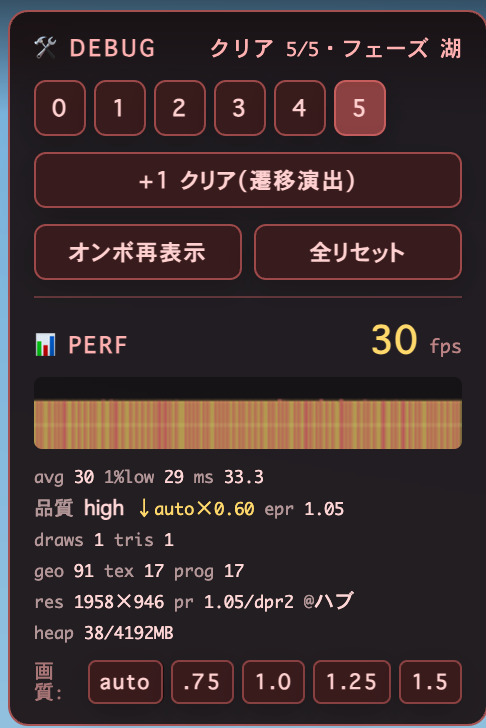

`?debug=1` を付けると画面左上に表示されるパネルです（右図）。上段の **DEBUG** がクリア状態の操作、下段の **PERF** がパフォーマンス計測になっています。

- **起動方法** — URLに `?debug=1` を付けてアクセスします（例: `http://localhost:5173/?debug=1`）。画面左上にデバッグパネルが表示されます。
- **できること**
  - **クリア数を 0〜5 に即設定** — `0`〜`5` のボタンで通常曲のクリア数を直接指定（リロードで確定）。**`5` を押せば全クリア状態＝湖に到達し、シークレット曲「こたえて」が即解放**されます。
  - **+1 クリア（遷移演出つき）** — 次の1曲をクリア扱いにし、フェーズが移り変わる遷移演出を確認できます。
  - **オンボ再表示 / 全リセット** — 初回ガイドの再表示、進行状況のリセット。
  - **パフォーマンスHUD（PERF）** — 右図下段。**FPS・avg／1%low・フレーム時間(ms)**に加え、**現在の画質設定と自動スケール倍率（例: `品質 high ↓auto×0.60`）・draws／tris・テクスチャ／プログラム数・解像度・ヒープ使用量**までリアルタイム表示。下端の `auto / .75 / 1.0 / 1.25 / 1.5` ボタンで**画質倍率をその場で切り替えて負荷を体感**できます。
- このパネルは `?debug=1` のときだけ動的に読み込まれ、通常プレイ（クエリなし）には一切影響しません。
- 公開URL（GitHub Pages）は**検証ビルドで配信**しているため、デプロイ済みのサイトでもそのまま `?debug=1` が使えます（仕組みは [デプロイ](#デプロイ--公開ビルドと検証ビルドの出し分け) を参照）。

<br clear="all">


---

## コンセプト

- **6曲を6つのアプリとして作り分けた。** 操作・演出・ミクの見せ方は曲ごとに別設計。共通化を捨てて、楽曲ごとの魅力を最優先しています。
- **各曲には「問い」がある。** 「この瞬間を永遠にできるか」「終わりの後に何が残るのか」——曲ごとのテーマが、操作と演出の軸になっています。
- **選曲画面が一本の筋になる。** 楽曲選択画面は水の循環（霧・雲・雨・水たまり・小川…）で湖へつながる風景。プレイした曲数に応じて景色が段階的に移り変わります。

---

## 水の循環 — クリアで育っていく6つの景色

選曲画面の風景は、通常曲をクリアするたびに **晴れ → 雲 → 雨 → 水たまり → 小川 → 湖** と段階的に移り変わります。「湖のソナーレ」へ至るまでの**水の循環**を、選曲画面そのものに重ねた仕掛けです（すべてThree.jsによるコード生成。画像素材は使っていません）。

<table>
  <tr>
    <td align="center">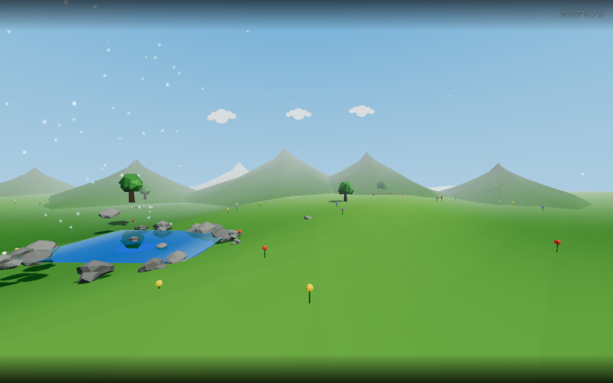<br><b>晴れ</b><br><sub>0曲クリア・はじまり</sub></td>
    <td align="center"><br><b>雲</b><br><sub>1曲クリア・空に雲が集まる</sub></td>
    <td align="center">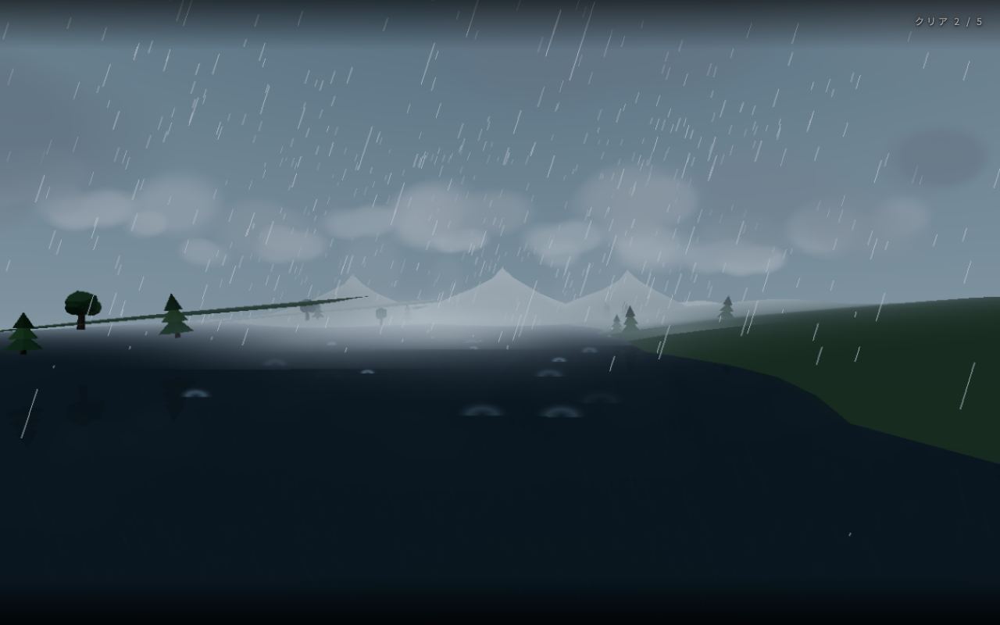<br><b>雨</b><br><sub>2曲クリア・雨が降りはじめる</sub></td>
  </tr>
  <tr>
    <td align="center">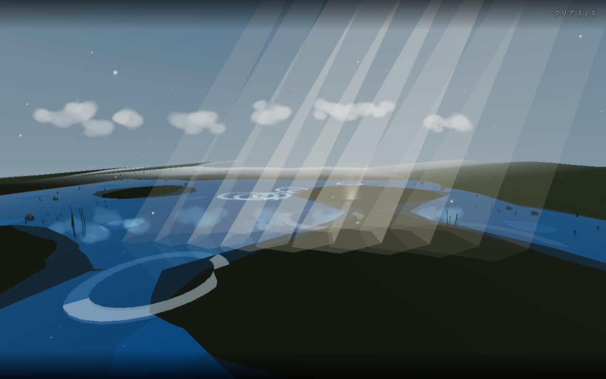<br><b>水たまり</b><br><sub>3曲クリア・雨上がりの光</sub></td>
    <td align="center">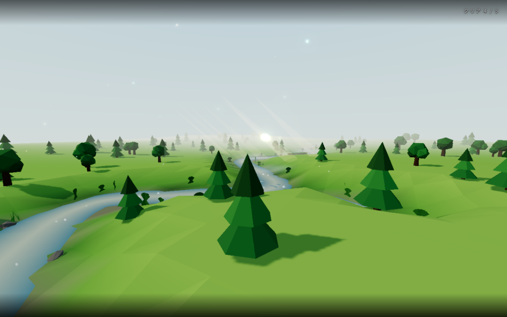<br><b>小川</b><br><sub>4曲クリア・水が流れ出す</sub></td>
    <td align="center">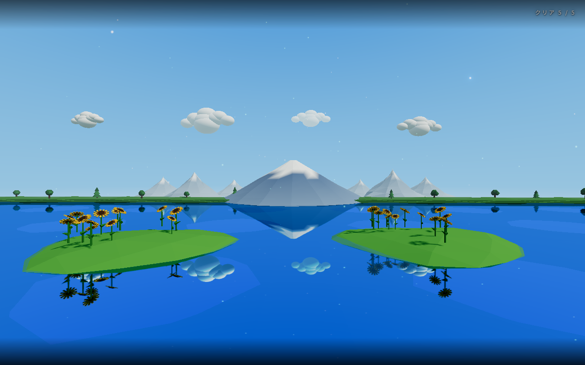<br><b>湖</b><br><sub>5曲クリア・湖に到達＝シークレット曲解放</sub></td>
  </tr>
</table>

---

## 体験の流れ

1. **タイトル** — 水面のコースティクス（屈折で揺らぐ光）が漂う入口。タップで物語が始まります。
2. **プロローグ** — 短い導入テキストが、これから訪れる世界へ誘います（再訪時・`?skipIntro=1` で自動スキップ）。
3. **選曲画面（水の循環の風景）** — 並んだ波紋から1曲を選びます。波紋にカーソルを合わせると曲名が浮かび、クリック／タップでその曲の世界に潜ります。最初は通常曲5曲が並び、5曲をクリアすると6つ目の**シークレット曲が湖に現れます**。

   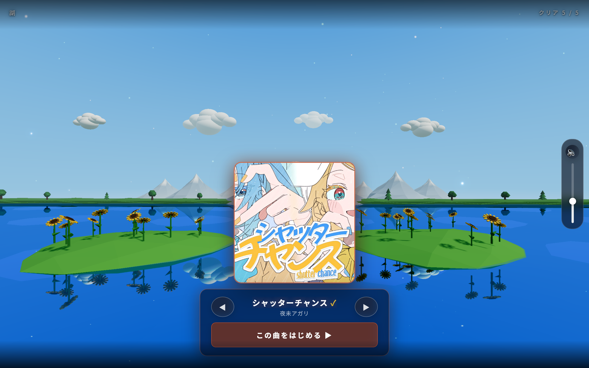

   *選曲画面。湖に浮かぶサムネイルを左右の矢印で選び、「この曲をはじめる」でその曲の世界へ。クリア済みの曲には ✓ が付きます。*
4. **楽曲シーン** — その曲だけの操作と演出で1曲を体験。曲に入るたびに**その曲専用のチュートリアル**（コンセプトカード）が出て、迷わず遊べます。
5. **結果と帰還** — 曲が終わると「あなたの結果」が刻まれ、**「楽曲選択画面へ」ボタン**を押すと選曲画面へ戻ります（自動では戻りません）。クリアした曲数だけ風景が移り変わり、5曲すべてをクリアすると**エンディング**を経てシークレット曲が解放されます。

### 操作方法

主導線は**クリック／タップ**です。キーボードは補助として使えます。

| 操作 | 動作 |
|---|---|
| マウス / タッチ | 選曲画面で波紋を選ぶ・歌詞や演出に触れる（曲ごとに異なる） |
| **Space** | 再生 / 一時停止 |
| **Escape** | 選曲画面へ戻る |
| **← / →** | 前後の曲へ切り替え |

> 各曲で操作が変わるため、曲に入った直後に**その曲専用のチュートリアル**が表示されます。「何をすればいいか」は必ず最初に提示されます。

**推奨環境**: PC Chrome / iOS Safari / Android Chrome。スマートフォンは9:16の縦画面に最適化（黒帯レターボックス）しています。

---

## 設計を貫く2つの方針

本作には、審査の観点に対して意図的に貫いている2つの軸があります。これは「迷った末の妥協」ではなく、**最初から選び取った設計判断**です。

### 方針A — 共通アプリにせず、曲ごとに作り分ける
各曲の魅力を最大限に引き出すため、共通の遊び方を全曲に当てはめるのではなく、**曲ごとに専用の操作・演出を持つアプリを作り分けています**。一貫性よりも楽曲ごとのユニークさを優先した意図的な決定です。そのぶん生じる学習コストを魅力に転換するため、各曲に専用のチュートリアルと導入演出を用意し、曲に入った直後に「何をすればいいか」を毎回提示しています。

### 方針B — 初音ミクの3D表現は曲ごとに個別設計する
**「主役にできないなら出さない」** を原則に、曲ごとにミクの見せ方を **主役化／静かな主役／影絵（脱literal）／モデルなし** から選んでいます。3Dモデルを出した瞬間に既存のMMD・ライブ映像と比較されるため、ポリゴンモデルの存在感だけに頼らず、**シルエット・タイポグラフィ・色（ティール）・影・パーティクル**でも"そこに居る感"を作っています。

| 曲 | ミク表現の方針 | 具体 |
|---|---|---|
| こたえて | **主役化** | 全曲で唯一、ビートに合わせてボーンが律動して踊る |
| シャッターチャンス | **被写体で主役** | 三点照明＋回り込みカメラで「撮られる存在」に |
| アフター・ザ・カーテン | **脱literal（影絵）** | 逆光のティール発光シルエット＝公演後の孤独な演者 |
| 世界最後の音楽隊 | **静かな主役** | あえて踊らせず、ゼロ重力で静かに漂う |
| トリツクロジー | **鏡像が概念** | 地上と水鏡に2体、片方は溶けて消える |
| TAKEOVER | **モデルなし→実体化** | 解読中は暗号化シルエット、クリアで復号して実体化 |

---

## 技術的な挑戦と工夫

> イノベーション軸。「歌詞を出すだけ」では到達できない部分に、どんな技術的工夫を施したか。

### 1. TextAlive の粗いタイマーを rAF 解像度へ補間
TextAlive App API のタイマーは 100〜1000ms 間隔で更新されます。そのまま歌詞アニメーションに使うとカクつくため、`requestAnimationFrame` 解像度に**自前で補間**しています（[BaseSong.js](src/songs/BaseSong.js) `getSmoothedTime()`）。
補間中にうっかり公式の `currentTime` へ巻き戻すと歌詞の経過時間が負になり **opacity=0 で歌詞が消える**——この罠を踏まないよう、巻き戻さない設計に固めています。歌詞は全曲で「主役として読める」ことを最優先にしました。

### 2. 本物の暗号を「解読」するインタラクション（TAKEOVER）
TAKEOVER の歌詞は、見た目だけ暗号風にしたのではなく、**Web Crypto API の AES-256-GCM で実際に暗号化**しています（[song-takeover.js](src/songs/song-takeover.js) — 毎回ランダムな96bit IV で暗号化、シーン内で生成した鍵で復号）。クリックするたびに本物の暗号文が復号され、歌詞が姿を現します。「世界を奪還する」というテーマを、演出ではなく**実装そのもの**で裏打ちしています。

### 3. 6曲を「6つのアプリ」として遅延ロードする
全曲を初回バンドルに含めると重くなるため、各曲シーン（＋Three.js / PixiJS / VRM）を**動的 `import()` でチャンク分割し、選曲した瞬間だけ取得**しています（[main.js](src/main.js) `SONG_LOADERS` / `switchToSongScene`）。ロード待ちは選曲→楽曲シーンの**遷移カーテンで隠蔽**。さらに、再デプロイでハッシュが変わった古いチャンクの 404 を検知して自動リロード復帰する仕組み（無限ループ防止ガード付き）も入れています。

### 4. VRMモデルの「開幕暴れ」を抑える SpringBone 制御
VRMにスケールやポーズを当てた直後、SpringBone（揺れもの物理）が初期状態とのズレで**ツインテールが逆立つ**現象が起きます。これをロード直後にワールド行列を更新してから揺れものを静止状態へスナップさせて解消しています（[vrm.js](src/utils/vrm.js) `settleSpringBones`）。あわせて、初音ミクの陶器のような質感のために Phong + Toon + Matcap を融合した独自シェーダー（[MMDToonShader.js](src/utils/MMDToonShader.js)）も用意しています。

### 5. サーバなしで成立する「創作の循環」（lakeMemory）
「ユーザーの創作が次の創作を呼ぶ」擬似循環を、**サーバを一切使わず localStorage だけ**で実装しています（[lakeMemory.js](src/lake/lakeMemory.js)）。現在は「シャッターチャンス」で選んだベスト1枚が波紋として湖に堆積し、別の曲の湖に再来します（上限を設けて古いものから自動廃棄）。静的Webアプリの制約の中で「世界が続いていく感触」を作る試みです。

### 6. スマホ縦持ちを「座標系シム」で支える
スマートフォンでは9:16の縦ステージに黒帯レターボックスで最適化しています。各曲の演出コードを書き換えずにこれを成立させるため、`window.innerWidth/Height`・`clientX/Y`・`getBoundingClientRect` を `Object.defineProperty` で論理座標へ**透過的に横取りする座標系シム**を用意しました（[stage.js](src/core/stage.js)）。縦持ち時は `#app` を90°回転させて画面に内接させます。曲側は「常に16:9で動いている」つもりのまま、スマホに対応できます。

### 7. 選曲画面の湖と、育っていく景色
選曲画面は3Dの夜の湖（[WorldUI.js](src/lake/WorldUI.js) / [LakeShader.js](src/lake/LakeShader.js) / [RippleSystem.js](src/lake/RippleSystem.js)）。6曲が波紋として浮かびます。クリアした曲数に応じて、霧・雲・雨・水たまり・小川…と**水の循環の景色が手続き的に育って**いきます（[phases/](src/lake/phases/)）。

### 8. クラッシュさせない堅牢化
Chrome / iOS のメディア割り込み（AbortError）や TextAlive の並列ロード競合は、ユーザーにとってはクラッシュではありません。これらを `unhandledrejection` ハンドラで握りつぶし、強制終了扱いにしないようにしています（[main.js](src/main.js)）。各曲は `destroy()` で rAF 停止・リスナー解除・Three.js / PixiJS リソースの dispose を徹底し、曲切替でのメモリリークを防いでいます。

---

## 各楽曲の詳細仕様（隠し要素まで）

共通して、各曲は **テーマの問い**・**専用の操作**・**ミク表現の方針**・**あなただけの結果** を持ちます。
選曲画面には通常曲5曲が並び、5曲すべてをクリアするとエンディングを経てシークレット曲「こたえて」が湖に現れます（表は選曲画面に並ぶ順）。

| 曲 | アーティスト / ボーカル | 体験の核 |
|---|---|---|
| **シャッターチャンス** | 夜未アガリ / 初音ミク & 鏡音リン | 完璧な一瞬を撮る、カメラ視点の撮影体験 |
| **アフター・ザ・カーテン** | Rulmry / 初音ミク | 暗転した舞台を、スポットライトで照らし出す |
| **世界最後の音楽隊** | 夏山よつぎ × ど〜ぱみん / 初音ミク | 歌詞を色のオーブに変え、夜空に花火を打つ |
| **トリツクロジー** | 鶴三 / 鏡音リン | 月がめぐり、地上と水鏡の世界が入れ替わる |
| **TAKEOVER** | Twinfield / 初音ミク | 暗号化された歌詞を解読し、世界を奪還する |
| **こたえて**（シークレット） | imie / 初音ミク | 歌詞の葉を足場に、ミクがひまわりを登りきる |

---

### 📸 シャッターチャンス（夜未アガリ）— 「この瞬間を永遠にできるか」

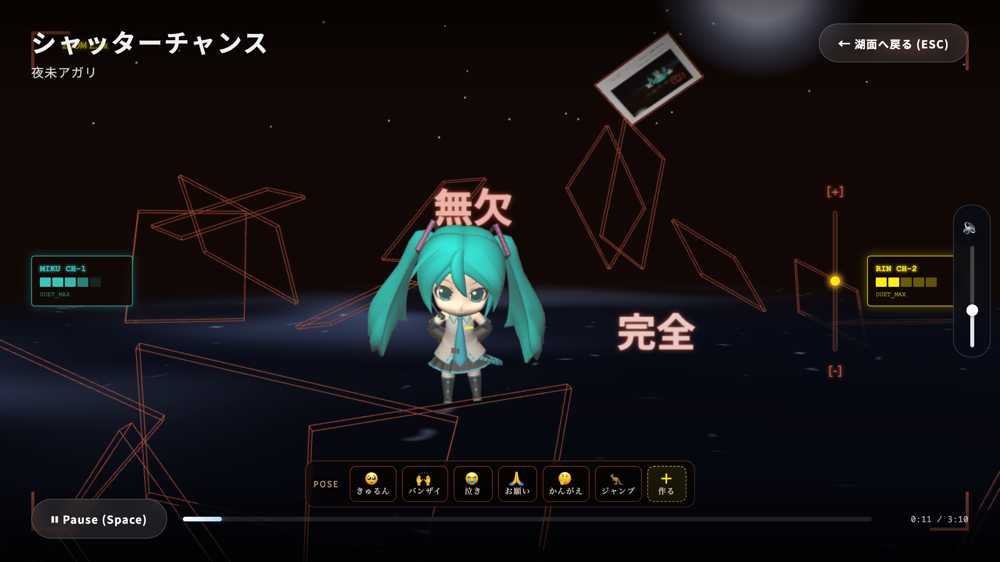

カメラ視点で、ステージを動き回るミク or リンを撮影するデュエット曲です。

- **操作** — 曲開始前に**被写体（ミク／リン）を1体選択**。クリック／Enter／タップでシャッター。ドラッグでカメラが被写体を回り込み（方位角±143°・仰角±28°）、ホイールやW/Sキーでズーム（1.2〜3.2倍）。
- **★ベストショット判定** — まず**構図**（被写体が画面中央に収まり、顔が見切れていない）が必須条件。そのうえで「**サビ／デュエット中**」「**象徴的な歌詞**（"シャッター""一瞬""永遠"など）が映り込む」「**構図がほぼ完璧**」のいずれかを満たすと★に。
- **ビート同期＆AFロック（隠し要素）** — 直前のビートから**±150ms以内**にシャッターを切ると被写体が一瞬にっこり笑い、台紙がパステルレインボーに。AFスコープに歌詞が吸着すると赤→緑に変わり「**NOW!**」、ロック成功で「**★ TARGET LOCKED**」。
- **ポーズ作成機能（被写体を自分でポージング）** — 撮るだけで終わらせず、**被写体のポーズをユーザー自身が作れる本格的なポーズ・エディタ**を搭載しています。「かわいいポーズ」バーのプリセットに加え、「＋作る」から専用エディタ「**ポーズを作る**」を起動できます。
  - **2つの編集モード** — スマホ・初心者向けの**かんたん**（頭・上半身・両腕）と、肩・手首・脚まで触れる**こだわり**（全身）。
  - **土台プリセット＋表情モーフ** — 立ち姿のベースを選んで微調整でき、表情（ウィンク／にっこり／なごみ／びっくり 等）も付けられます。
  - **破綻しない設計** — 関節ごとに可動域（`BONE_CLAMP`）を設けてスライダー範囲を制限。**物理的にあり得ない崩れ方をしない**ようにしてあります。
  - **保存して撮る** — 作ったポーズは `localStorage` に保存され、「このポーズで撮る」で**そのまま撮影に持ち込めます**。ダンスのプリセットは `[` `]` キーでもリアルタイム切替できます。
- **フィナーレ／結果** — 終盤、撮った写真（最大12枚）が**コンタクトシート**として舞い込み、あなたが決定的な1枚を選ぶとスポットライトで昇格演出。選んだ1枚は**波紋となって湖へ流れ**、いつか別の曲の湖に再来します。結果には「撮影枚数・候補枚数・ベスト選定・ターゲットロック成功回数」が刻まれます。
- **ミク表現** — 三点照明（キー＋ティールのリムライト）と被写体中心の回り込みカメラで、ミク・リンを「撮られる主役」に。歌詞スプライトは毎フレームでカメラに正対させ、どの角度からでも読めるようにしています。

### 🎭 アフター・ザ・カーテン（Rulmry）— 「終わりの後に何が残るのか」

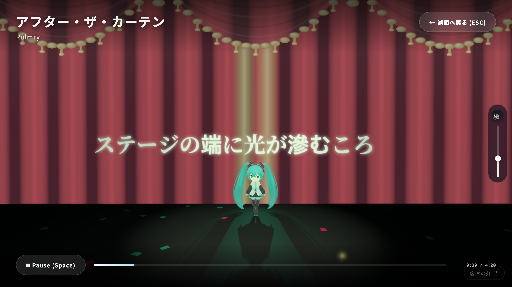

暗転した舞台で、スポットライトだけを頼りに闇に隠れた歌詞とミクを照らし出します。

- **操作** — マウス／指で動かすスポットライトは**押している間だけ**点灯。歌詞は画面下半分に現れ、長い句は助詞で読みやすく分割されます。
- **照らし切り判定** — 累計**2.2秒**しっかり照らすと歌詞が膨らんで発光→弾け、**バラの紙吹雪**になって床に積もります。サビで全体が明るくなっても自動では弾けず、**あなたが照らした歌詞だけ**が破裂します。
- **客席の残り火（隠し要素）** — 照らし切った歌詞は消える瞬間、放物線を描いて**客席の灯**に昇華し、ろうそくのように揺れながら終演後も消えずに残り続けます。
- **緞帳と湖の移ろい（隠し要素）** — 開幕前は緞帳が開いて夜の湖が覗き、曲が始まると左右から降りて視界を覆います。終盤は**照らし切った数に応じて緞帳が開き**、その先の湖が夜→晴天へ。床の紙吹雪は一斉に舞い上がり、中央へ渦巻いて湖へ吸い込まれていきます。
- **結果** — 「客席に残った灯 N」「終わりの後にも、灯りは消えない」。
- **ミク表現** — 背後からのティール発光リムライトで輪郭だけを神秘的に光らせた**逆光のシルエット**。呼吸で脈動し、照らされている歌詞の方へ顔だけを向け、終演では星空を見上げます。「公演後の孤独な演者」を影絵として表現しました。

### 🎆 世界最後の音楽隊（夏山よつぎ × ど〜ぱみん）— 「空はどんな色？あなたはどんなカタチ？」

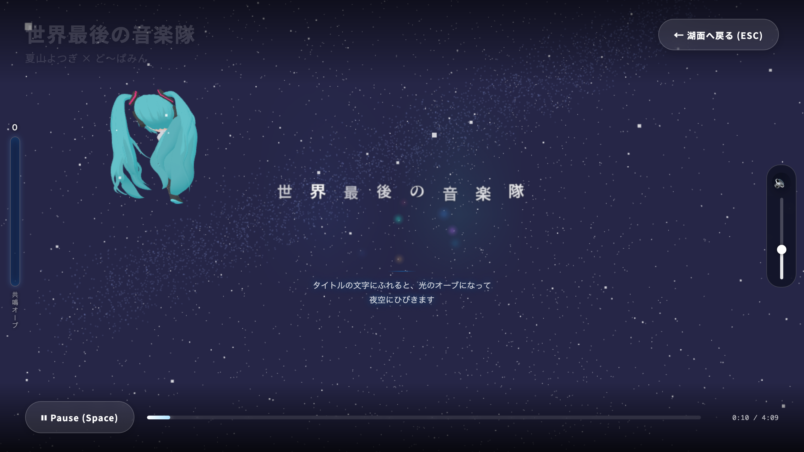

浮かぶ歌詞に触れ、言葉の意味を色に変えて夜空に打ち上げます。

- **操作** — 浮遊する歌詞に触れると、言葉の意味に応じた**色のオーブ**が生まれ、画面左端のゲージに色の層として積もります（最大16層、75%で「もうすぐ花火」の脈動）。
- **意味→色のマッピング（仕組み）** — 歌詞の単語を意味で6色に振り分けます。**青**＝空・海・涙・水／**赤**＝夕・火・熱・心臓／**黄**＝星・光・朝・輝／**緑**＝葉・森・生・命／**紫**＝夜・闇・終・幕／**白**＝雪・音・歌・声。複数該当時は優先順で決定します。
- **花火の連鎖** — サビでオーブはすべて**花火**になり、多く集めるほど夜空が大連鎖に（12個以上でさらに豪華に）。
- **イントロの予行（隠し要素）** — 歌詞が始まる前、曲名を構成する文字が光のスプライトとして漂い、タップでオーブ化。触らなくても時間で自動的に花火へ昇華するので、**無操作でも操作の流れ全体を体験**できます。
- **結果** — 集めた全オーブの色を平均した「**その時のあなただけの夜空の色**」が1色のスウォッチとして記憶されます。
- **ミク表現** — あえて踊らせない**「静かな主役」**。ゼロ重力で静かに漂います。

### 🌗 トリツクロジー（鶴三 / 鏡音リン）— 「水面に立つあたし、水面に映るあたし。どっちが本物なのかな」

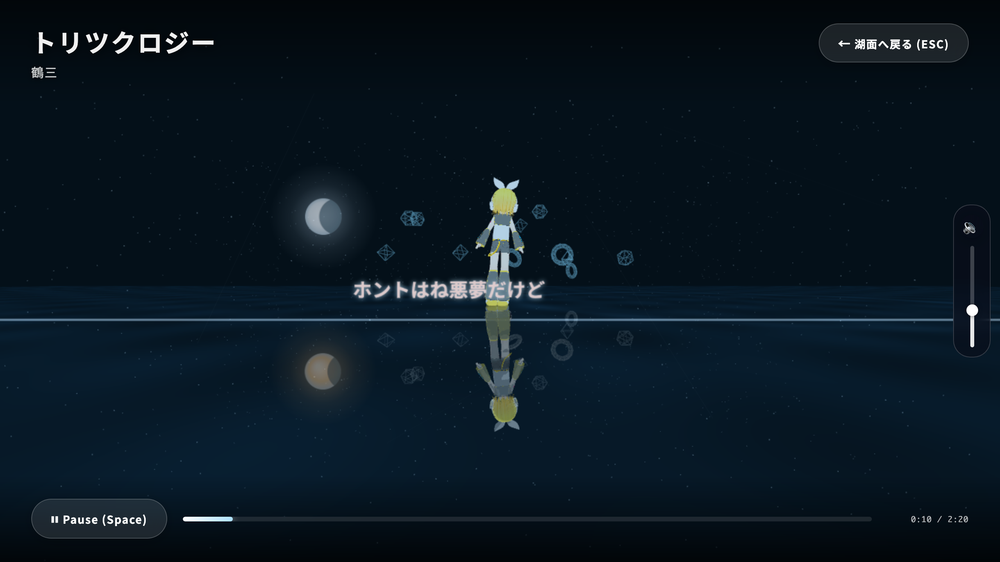

画面中央の水面ラインで、上の**地上世界**と下の**水鏡の世界**が同時に進みます。

- **操作** — 地上に昇る歌詞／水面に逆さに映る歌詞をタップすると、その世界の月が満ちていきます（タップは2段階のレイキャストで、多少ずれても近い歌詞を拾います）。
- **月の天秤（仕組み）** — 上下の月は一つの天秤を奪い合い、`balance` 値で優勢が決まります。地上タップで世界の彩度が戻り、鏡像タップで現実が褪せる——タップが世界の見え方そのものを変えます。
- **時間軸の演出** — 約1:01で**上下の世界が反転**。約2:04で月が水に沈むとき、その瞬間に**満ちていた側が「本物」として確定**し、もう一方の鏡音リンは光の粒へと溶けて消えます。拮抗時は物理的に「上」にある世界が選ばれます。
- **鏡像の不気味さ（隠し要素）** — 水鏡のリンは呼吸の位相がずれ、たまにこちらを見る。「鏡なのに独立した意思がある」不安を演出しています。曲が進むほど世界に**亀裂**が走り、終盤に向けて壊れていきます。
- **結果** — 「残ったのは — 地上／水面」「地上の月 N% ／ 水面の月 N%」「もう一人のあたしは、光になって溶けた」。
- **ミク／リン表現** — 地上と水鏡に2体のリンを配置（水鏡側は上下反転・半透明）。**鏡像という概念そのもの**を演出の核に据えています。

### 🔓 TAKEOVER（Twinfield）— 「世界を変えるのは誰か」

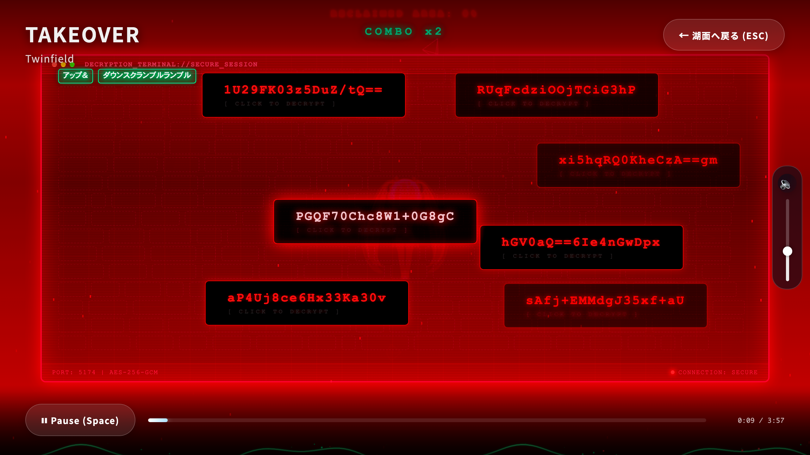

赤く暗号化された歌詞を解読し、侵食された世界を奪還する時間制限つきの認知戦です。

- **操作** — 暗号文をクリック／タップで解読。解読した歌詞は背景タイルへ吸い込まれ、世界が侵食色から奪還色へ。上部には**制圧率**がリアルタイム表示されます。
- **本物の暗号（仕組み）** — 表示されている暗号文は **AES-256-GCM で実際に暗号化**された本物のバイト列（[技術的な挑戦](#技術的な挑戦と工夫)の②参照）。クリックで復号して歌詞が現れます。
- **コンボと綱引き** — **4秒以内**の連続解読で**コンボ**発動。クリックで制圧率が上がり、無操作だと毎秒じわじわ減衰（サビ中はより厳しく）。制圧率に応じて世界の色が**赤→橙→黄緑→緑**の4段階で遷移します。
- **演出（隠し要素）** — 開幕は赤い「**WARNING**」グリッチがノイズで飛散。クリック地点には白→シアンの復号バーストが走り、コンボが伸びるほど波紋・粒子・信号線が増えます。
- **判定／結果** — 曲終わりの8秒前に判定。制圧率**50%以上で COMPLETE／RECLAIMED**、未満で **FAILED**。タイルが爆散しブートログが流れ、世界がシアンに切り替わります。結果には「制圧率・最大コンボ」が刻まれます。
- **ミク表現** — あえて3Dモデルを**暗号化シルエット**（敵支配の暗赤）として伏せておき、**クリアした瞬間に本来の彩色へ復号**。背後からシアンの逆光に包まれて実体化します。「奪還」をモデルの状態変化そのもので描いた一曲です。

### 🌻 こたえて（imie）— 「あなたが僕ならばどんな答えを出すでしょうか」（シークレット曲）

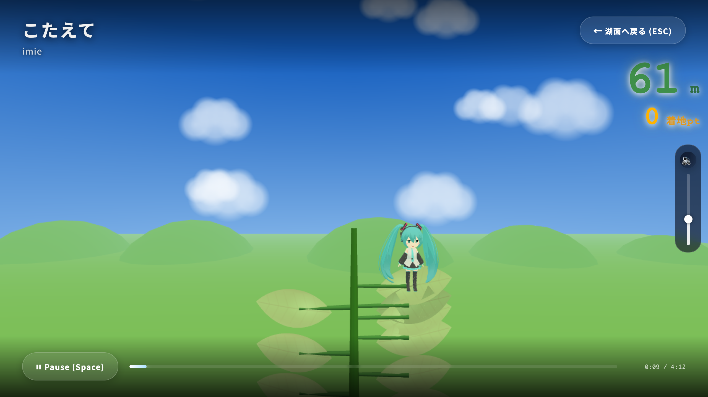

**通常曲5曲をすべてクリアすることで解放される、隠しゲームです。** 5曲クリア後にエンディングを経て、それまで何もなかった湖の静寂に6つ目の波紋として現れます（最初から選ぶことはできません）。他の5曲とは操作も世界観も大きく異なる、到達者だけが遊べる"ごほうび"として設計しています。

> 💡 審査などで5曲を通しでプレイせずに確認したい場合は、冒頭の **「🛠 デバッグモード（審査用の救済措置）」** で `?debug=1` を付けて `5`（全クリア）を押すと、この曲を即解放できます。

- **物語** — 地面に芽吹いたひまわりの双葉から始まり、曲が進むほど**茎が空へ伸びて**いきます。歌われた歌詞が**「葉っぱ」の足場**になって茎の左右に生え、ミクは葉から葉へと自動で登っていきます。
- **歌詞→葉の仕組み** — 歌詞は品詞で**文節結合**され（助詞・助動詞は直前の葉に連結）、**文字数に応じて葉が大きく**なります。空きをタップすると足場を生やせ、**連打すると一度に最大4枚**を量産する"暴走"モードに。
- **必ず咲く設計** — ミクは**落ちず・ミスもなく、必ず満開のひまわりに到達**します。未着地の葉が溜まると（6枚以上）**メガジャンプ**で一気に飛び、積み上がるほど高く跳ねます。高度HUDは到達感を強調するため数値を10倍に水増し表示。
- **隠し要素** — 右下のボタンから**絵文字リアクション**（❤️👍🎉👏✨😊）がふわふわ浮上。ゴール時は黄金角の螺旋配置で**大輪のひまわり**が咲き、空が一瞬白く飛んで「こたえは、まだ空の上。」の一行が残ります。
- **結果** — 「到達こたえ高度 X m ・ 生やした葉 Y枚」。
- **ミク表現** — 全曲で唯一、**ビートに合わせてボーンが律動して踊り**ながら登攀します（`applyGroove`）。

---

## 完成度への作り込み

> 完成度軸。初見でも迷わず、最後まで破綻なく、レギュレーションを守って成立しているか。

### 初見でも迷わせない
- 各曲に**専用チュートリアル**（コンセプトカード）を用意し、曲に入った直後に必ず表示。「何をすればいいか」を毎回最初に提示してから再生に入ります（[BaseSong.js](src/songs/BaseSong.js) `showTutorial`）。
- 「操作が曲ごとに違う」という方針Aの学習コストを、導入演出の手厚さで魅力へ転換しています。

### 品質を作り込む検証ハーネス
仕上げのために、目視に頼らない自動検証を複数用意しています。
- **全6曲の自動E2E** — Playwright で各曲をロード→再生→破棄まで自動走行させ、コンソールエラー・JS例外・HTTP 4xx を集約（`eval_master.js`、`tests/e2e.spec.js`）。
- **歌詞見切れ監査** — 実描画から歌詞のはみ出しを検出する監査スクリプトで、特にスマホ横持ちでの可読性を点検。
- **ダンス検証** — VRMのボーン値を時系列サンプリングしながら動画キャプチャし、踊りの破綻を確認（`design/capture-dance.mjs`）。
- **回帰チェックリスト** — 改修時の手動確認項目を [docs/regression-checklist.md](docs/regression-checklist.md) / [docs/visual-review-checklist.md](docs/visual-review-checklist.md) に整理。

### 最後まで破綻させない堅牢性
- 全レイヤー（曲・フェーズ・湖）で `destroy()` を実装し、`cancelAnimationFrame`・リスナー解除・Three.js/PixiJS リソースの dispose を徹底（曲切替時のメモリリーク防止）。
- iOS Safari の自動再生ポリシーに対応（AudioContext をユーザー操作後に開始）。

### モバイルとアクセシビリティ
- スマホは9:16固定ステージ＋黒帯レターボックス、`env(safe-area-inset-*)` でノッチ/ホームバーを回避。
- `prefers-reduced-motion` で過剰なアニメーションを抑制。キーボードは補助操作として利用可能。

---

## 技術スタック

| 領域 | 採用技術 |
|---|---|
| ビルド | Vite（静的Webアプリ。GitHub Pagesデプロイ） |
| 歌詞・タイミング | TextAlive App API（`textalive-app-api`） |
| 3D / 描画 | Three.js / PixiJS / @pixiv/three-vrm（ミクモデル） |
| 暗号 | Web Crypto API（AES-256-GCM／TAKEOVER） |
| 永続化 | localStorage（クリア状況・創作の波紋・プロローグ視聴済み） |
| テスト | Playwright（ビジュアル / E2E） |

アーキテクチャの詳細・各曲の実装方針・レビュー手順は [docs/ONBOARDING.md](docs/ONBOARDING.md) にまとめています。

---

## 動かし方（セットアップ）

静的Webアプリです。Node.js があれば動きます。

```bash
# 1. 依存関係をインストール
npm install

# 2. TextAlive App API のデベロッパートークンを設定
cp .env.example .env.local
#    .env.local を開き、VITE_TEXTALIVE_TOKEN=<あなたのトークン> を記入

# 3. 開発サーバーを起動
npm run dev
```

起動したら表示されるURL（既定 `http://localhost:5173`）をブラウザで開いてください。

| コマンド | 内容 |
|---|---|
| `npm run dev` | 開発サーバー起動（開発者ツールは常に有効） |
| `npm run build` | 公開ビルド（`dist/` に出力・開発者ツールOFF） |
| `VITE_DEV_TOOLS=1 npm run build` | 検証ビルド（開発者ツールON。詳細は[デプロイ](#デプロイ--公開ビルドと検証ビルドの出し分け)） |
| `npm run preview` | ビルド結果をローカル確認 |
| `npm run test:visual` / `test:e2e` | Playwright によるビジュアル / E2E テスト |

> GitHub Pages への配信は `main` への push で動く GitHub Actions（[.github/workflows/deploy.yml](.github/workflows/deploy.yml)）が担います。詳しくは次節を参照してください。

---

## デプロイ — 公開ビルドと検証ビルドの出し分け

本作には、審査・開発に役立つ一方で一般公開には不要な**開発者向け機能**が2つあります。これらを**デプロイ単位でON/OFFできる**よう、環境変数 `VITE_DEV_TOOLS` 一つで切り替えるしくみを用意しています（判定は [src/core/featureFlags.js](src/core/featureFlags.js) に集約）。

対象は次の2つです（**ゲーム内のポーズ・エディタは対象外で、常に利用可能**です。出し分けるのは単独ページの方だけです）。

- **デバッグモード** — `?debug=1` で起動する審査用パネル（[🛠 デバッグモード](#-デバッグモード審査用の救済措置)）。
- **単独ポーズ作成ページ** — `/pose-editor.html`（MMDモデルのボーンを直接編集してポーズJSONを書き出す開発用ページ）。

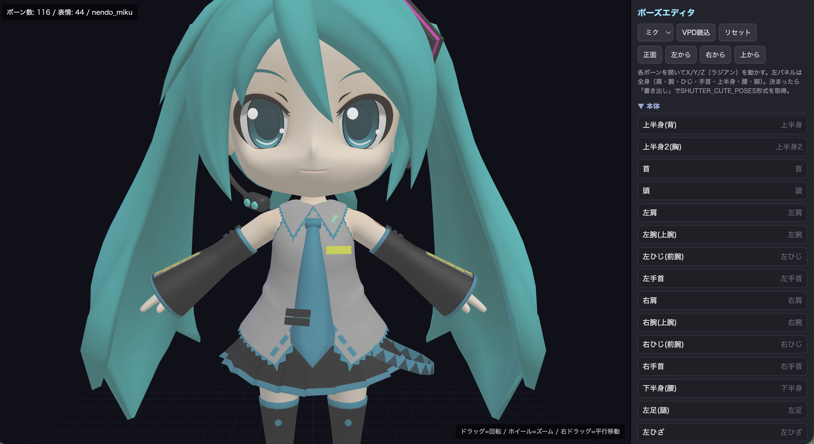

*`/pose-editor.html`。MMDモデル（例: nendo_miku・ボーン116／表情44）の全身ボーンをX/Y/Zで直接編集し、正面／左右／上からの定点ビューで確認しながらポーズを作成。`VPD読込` で既存ポーズを取り込み、完成したら `SHUTTER_CUTE_POSES` 形式で書き出して、シャッターチャンスのポーズプリセットに組み込めます。*

### なぜ出し分けるのか
デバッグモードと単独ポーズ作成ページは、審査・検証には便利ですが一般公開ビルドには余計です。かといってコードから削除すると再検証のたびに復元が必要になります。そこで**同じコードのまま1フラグで安全にON/OFF**できるようにし、「公開用」と「検証用」を作り分けられるようにしました。OFF時はデバッグパネルのチャンクごとビルドから除去され、`/pose-editor.html` も生成されません（`?debug=1` を付けても無効）。

### 2つのビルド
| ビルド | コマンド | デバッグ `?debug=1` | `/pose-editor.html` | 用途 |
|---|---|---|---|---|
| **公開ビルド** | `npm run build` | 無効（チャンクごと除去） | 生成しない（実機で404） | 一般公開 |
| **検証ビルド** | `VITE_DEV_TOOLS=1 npm run build` | 有効 | 配信 | 審査・内部検証 |

- ローカル開発（`npm run dev`）では `import.meta.env.DEV` により**常に有効**です。開発時にフラグ指定は不要。
- 本番ビルドでのみ `VITE_DEV_TOOLS=1` の有無で切り替わります。

### GitHub Pages は「検証ビルド」を配信
公開URL（GitHub Pages）でも審査員がデバッグモードでクリア状態を進められるよう、`main` への push で動く GitHub Actions（[.github/workflows/deploy.yml](.github/workflows/deploy.yml)）は **`VITE_DEV_TOOLS=1` を付けて検証ビルドをデプロイ**しています。これにより公開URL上でも `?debug=1` と `/pose-editor.html` が使えます。一般公開向けにこれらを伏せたい場合は、ワークフローの `VITE_DEV_TOOLS` を外す（または `0` にする）だけで公開ビルドに切り替わります。

---

## レギュレーション遵守

- 歌詞・楽曲タイミングは **TextAlive App API のみ**から取得。歌詞全文をローカルに埋め込んでいません。
- 課題の**6曲のみ**を使用しています。
- **AI生成物（画像・音楽・文章）を作品出力に含めていません**。
- マジカルミライ公式サイト掲載のイラスト・ロゴ・公式SNS素材は使用していません。**世界の表現はすべてコード生成**です。
- 使用している初音ミク・鏡音リンの**3Dモデルは、著作者から利用許可を得たうえで使用**しています。
- 選曲画面では課題曲のMVサムネイル画像を表示しています（規約で利用が認められている範囲）。著作権は各楽曲制作者に帰属し、クレジット画面に制作者名を明記しています。
- 動的サーバーを追加せず、**静的Webアプリ**として維持しています。

---

## クレジット

### 楽曲

楽曲・歌詞の著作権は各楽曲制作者に帰属します。

| 曲 | アーティスト | ボーカル |
|---|---|---|
| シャッターチャンス | 夜未アガリ | 初音ミク & 鏡音リン |
| アフター・ザ・カーテン | Rulmry | 初音ミク |
| 世界最後の音楽隊 | 夏山よつぎ × ど〜ぱみん | 初音ミク |
| トリツクロジー | 鶴三 | 鏡音リン |
| TAKEOVER | Twinfield | 初音ミク |
| こたえて（シークレット） | imie | 初音ミク |

### 3Dモデル

以下の3Dモデルを、いずれも作者から使用許可を得たうえで利用しています。

| モデル | 作者 | 配布元 |
|---|---|---|
| ねんどミクさん | maebari | <https://piapro.jp/t/wyAD> |
| ねんどリンちゃん | maebari | <https://piapro.jp/t/0aEn> |
| 鏡音リン / Wittrockiana_R1N（ウィットロッキアナ） | 602e | <https://piapro.jp/t/5hZ9> |
| 「初音ミク」VRM Model | 6666669（ROLOCK） | <https://booth.pm/ja/items/6690538> |

### BGM

選曲画面（湖の世界）のBGMにフリー音源を利用しています。

「静かな海鳴り」
作曲：蒲鉾さちこ
配布：DOVA-SYNDROME
URL：<https://dova-s.jp/bgm/detail/22518>
※音量調整・ループ編集を行っています
